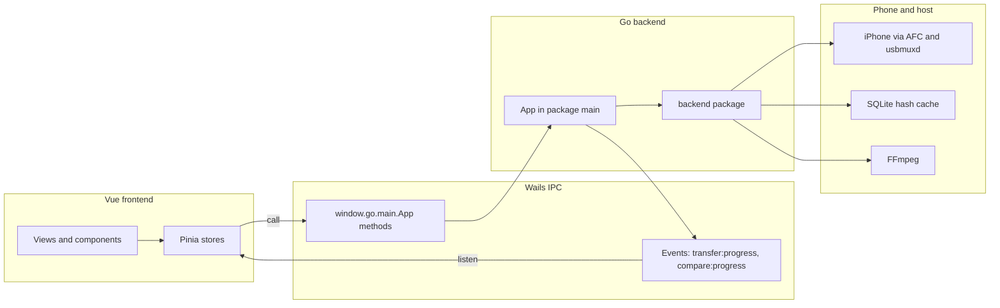
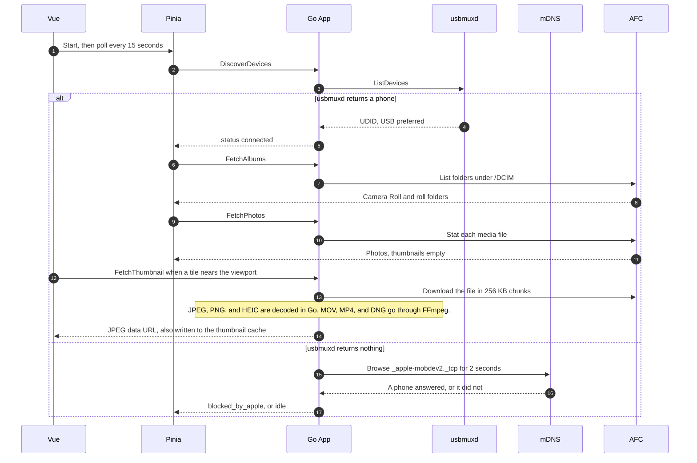
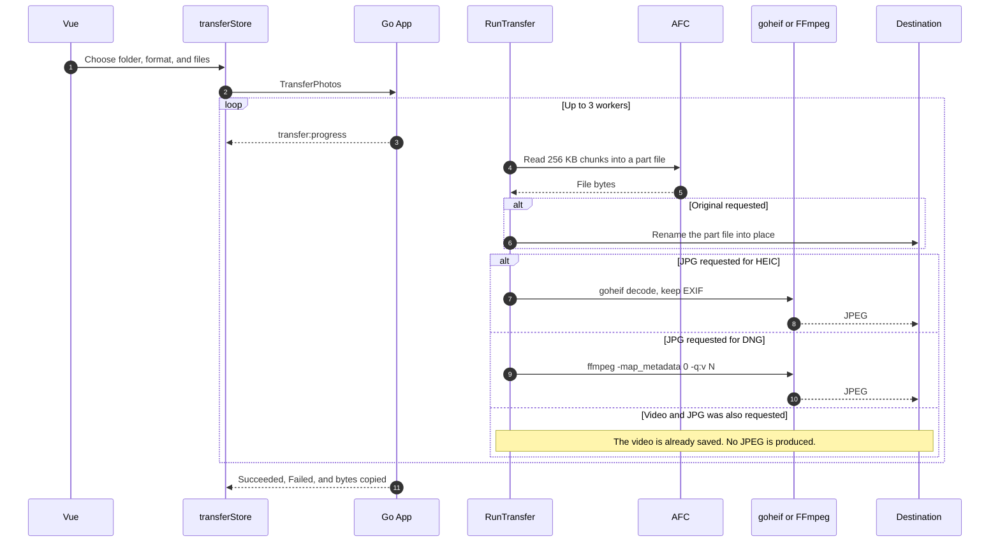
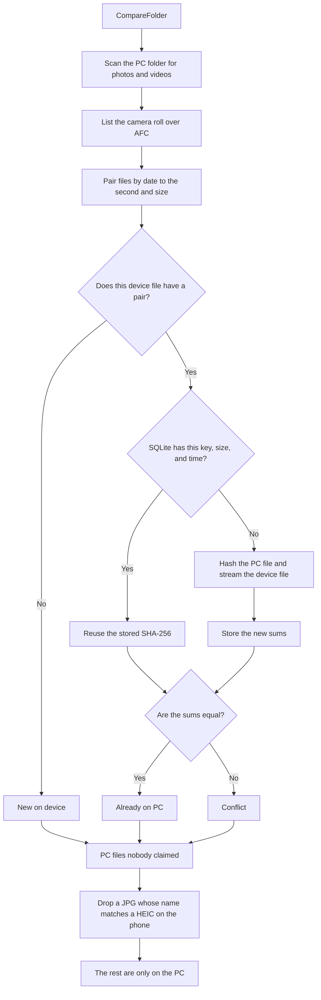

# Architecture

Photo Bridge is a Windows desktop app that lists the camera roll of a paired iPhone, previews it, copies files to a folder on the PC, and compares that folder with the phone. The Vue interface never talks to the phone itself. Every device call goes through a method on the Go `App` struct, which Wails binds into JavaScript.

## Tech stack

| Layer | Choice |
| --- | --- |
| Shell | [Wails v2](https://wails.io). The window is a WebView. `main.go` starts it with `wails.Run` and `Bind: []interface{}{app}`. |
| Backend | Go. Domain code lives in `backend/`. The bound `App` type lives in package `main` so the JavaScript path is `window.go.main.App`. |
| Frontend | Vue 3 (Composition API, `<script setup lang="ts">`), Pinia setup stores, Tailwind CSS, Vite. |
| Device access | [go-ios](https://github.com/danielpaulus/go-ios) over Apple File Connection (AFC). usbmuxd, shipped with Apple Devices, is the transport for USB and Wi-Fi Sync. |
| HEIC | `github.com/adrium/goheif` (a stand-in for `jdeng/goheif`). Decoding needs cgo and MinGW. See [DEVELOPMENT.md](DEVELOPMENT.md). |
| Video and DNG | FFmpeg on the host `PATH`. One frame for a preview, and a JPEG conversion for DNG. |
| Hash cache | SQLite through `modernc.org/sqlite`, a pure Go driver. The file is `%APPDATA%\PhotoBridge\hash-cache.db`. |
| Discovery diagnostic | mDNS (`github.com/grandcat/zeroconf`) for `_apple-mobdev2._tcp`. It never becomes the device list. |

A build with `-tags mock` swaps the phone and the library for sample data. A normal build does not contain that data.

## High-level components

The frontend calls `window.go.main.App.MethodName(...)` and wraps each call in `try/catch`. Long jobs do not stream their progress through the return value. `TransferPhotos` and `CompareFolder` block until they finish, and push progress with `runtime.EventsEmit`. The stores subscribe with `window.runtime.EventsOn`.

## Data flow 1: discovery and listing

On startup, and every 15 seconds after that, the device store calls `DiscoverDevices`. go-ios asks usbmuxd for devices. Each device id is the UDID. If the same phone appears over USB and Wi-Fi, the USB entry is kept.

When usbmuxd returns nothing, the backend browses mDNS for two seconds. A phone on the network with an empty usbmuxd list produces the status `blocked_by_apple`. That status means Wi-Fi Sync is not actually available to Apple Devices. An empty network as well produces `idle`.

After a device is active, the photo store loads albums and then the first album's files. `FetchPhotos` returns metadata only. A tile asks for `FetchThumbnail` when it scrolls near the viewport. The full file is downloaded in 256 KB chunks, resized so the long side is at most 400 pixels, and stored as a JPEG under `%APPDATA%\PhotoBridge\thumbnails`. JPEG, PNG, and HEIC are decoded in Go. MOV, MP4, and DNG are handed to FFmpeg.

Albums are only Camera Roll (`/DCIM`) and one album per roll folder such as `100APPLE`. Favorites, Screenshots, and user albums live in `PhotoData/Photos.sqlite`, which this app does not read. Width and height are reported as 0 because AFC does not provide them.

## Data flow 2: transfer and conversion

`TransferPhotos` accepts the device id, the selected photo ids, and options: original, JPG, or both; JPEG quality from 1 to 100; a destination folder; and an optional `YYYY/MM` or `YYYY/MM/DD` layout. One transfer runs at a time. Three workers each keep their own AFC connection so a long download does not block listing.

Each file is streamed to a temporary part file in 256 KB chunks. The original is renamed into the destination first. A JPG, when requested, is written beside it. If conversion fails after the original has been saved, that original stays and the photo is reported in `Failed`.

| Source | Original | JPG |
| --- | --- | --- |
| JPEG | Saved as the file itself. A second JPG is not encoded when the original is also kept. | Re-encoded at the chosen quality, or copied when quality is 100. |
| HEIC | Saved as `.HEIC`. | Decoded with goheif, EXIF kept, orientation baked into the pixels. Requires cgo. |
| DNG | Saved as `.DNG`. | FFmpeg, with `-map_metadata 0`. Quality 100 maps to `-q:v 2`, quality 1 maps to `-q:v 31`. |
| MOV, MP4 | Saved as the video. | Refused with "Cannot convert video to JPG" when JPG is the only output. "Original + JPG" saves the video and skips the JPEG. |
| PNG | Saved as `.PNG`. | Refused. PNG is not converted. |

Progress is the `transfer:progress` event about every 200 ms. `CancelTransfer` cancels the context between chunks and deletes the part file.

## Data flow 3: folder comparison

`CompareFolder` compares the camera roll with a PC folder, searched recursively. Hidden files and folders are skipped. Both sides include JPEG, HEIC, PNG, DNG, MOV, and MP4.

The first pass is cheap: date truncated to one second, plus size. A device file with no parseable date cannot match. Only pairs that share that signature are hashed. Hashing uses up to three workers. A SHA-256 is reused from SQLite when the cache key, size, and modification time still match. A miss is hashed and then stored. The cache is optional: if the database cannot be opened, comparison continues and hashes every candidate again.

Equal sums mean the file is already on the PC. The same signature with different sums is a conflict. No candidate means the file is new on the device. A PC file that no device file claimed is "missing on the PC", except a `.jpg` sitting next to a HEIC of the same name, which is treated as a copy this app produced.

Progress phases on `compare:progress` are `scanning`, `listing`, `hashing`, and `done`.

Cache keys are `local:` plus the lower-cased path, or `device:` plus the device id and photo id. The primary key is `(key, size, mod_time)`, so an edited file is a miss.

## Directory structure

`backend/` is the domain code. The Wails `App` does not contain listing, hashing, or conversion logic. It checks inputs, owns cancellation, and emits events.

| Area | Files |
| --- | --- |
| Device list | `discovery.go`, `discovery_real.go`, `discovery_mock.go` |
| Phone library | `afc_client.go` (AFC walk, 256 KB download), `photos.go`, `photos_real.go`, `photos_mock.go` |
| Previews | `thumbnails.go`, `exec_windows.go`, `exec_other.go` |
| Conversion | `convert.go`, `convert_heic.go` (`//go:build cgo`), `convert_noheic.go`, `exif.go` |
| Copy | `transfer.go` |
| Compare | `compare.go`, `hashcache.go` |

`src/` is the interface.

| Area | Files |
| --- | --- |
| Shell | `App.vue`, `main.ts`, `components/layout/` |
| Grid | `components/photos/PhotoGrid.vue`, `PhotoTile.vue` |
| State | `stores/deviceStore.ts`, `photoStore.ts`, `transferStore.ts`, `comparisonStore.ts`, `toastStore.ts` |
| Wiring | `composables/useDeviceDiscovery.ts`, `usePhotoLibrary.ts` |
| Contracts | `types/` including `wails.d.ts`, which lists only methods that exist on `App` |

Package `main` (`main.go`, `app.go`, `app_discovery.go`, `app_photos.go`, `app_transfer.go`, `app_compare.go`) is the Wails boundary. `wailsjs/` is generated and is not the source of the frontend types. The hand-written declarations in `src/types/` are.
